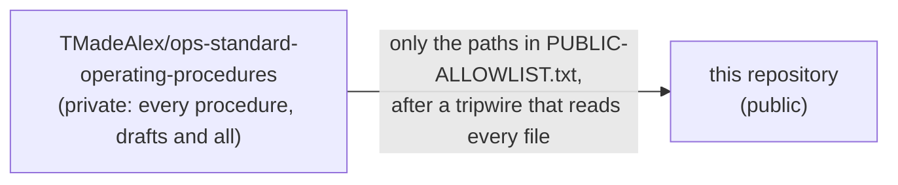
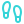

#  TMadeAlex · procedures, the public copy

> Set up as a gift by Christopher W ([@drasticstatic](https://github.com/drasticstatic)), a member of TMade Alex's
> TRADERMADE community, so that the home is ready whenever TMade Alex wants it. What stays here is TMade Alex's to decide.

A **procedure** says how an approved thing is done, step by step, so a person or their helper can do it without the
author in the room. This repository holds only the procedures an owner has chosen to show visitors, copied here by a
machine from the private procedures. Nobody edits it by hand.

##  How the pages get here

-  **Allowlist, not exclude list.** A procedure is private until an owner lists it. Forgetting to list one leaves it
  private: the safe failure.
-  **Every file is read before it leaves.** Text, the words inside every PDF, the text inside office files; anything a
  machine cannot read waits until a person has opened it and said so. Keys, agent notes and legal folders never leave.
-  **Nothing has arrived yet** if this page is the only one here. Nothing is listed, and nothing is waiting on anyone.

| This repository holds | Written by |
| --- | --- |
| this `README.md`, `banner/`, `LICENSE`, `LICENSE-CONTENT` | the first commit; the automatic copy never touches them |
| every other file (the procedures, their PDFs, `assets/icons/`) | the automatic copy only; never edited here |

 Once they are here, start with **SOP-COM-001** (*New to GitHub: your first hour*) and **SOP-OPS-001** (*How a change
travels*). The organisation's front door is its profile: [github.com/TMadeAlex](https://github.com/TMadeAlex).

TMadeAlex on GitHub · code MIT, words CC BY-SA 4.0 (`LICENSE`, `LICENSE-CONTENT`). Icons: Lucide (ISC), see <code>assets/icons/LICENSE</code>. Kept by the drasticstatic lab.
